# Talk to Figma MCP（本地改造版）

把 HTML 原型变成 Figma 画板的一条本地管线：MCP 服务 + WebSocket 中继 + Figma 开发版插件，
外加浏览器侧抽取脚本与推送体检脚本。给需要用 AI 客户端批量产出或回填 Figma 设计稿的人用。
核心价值是插件端多出的 17 条上游没有的命令（字体、变量、局部样式、SVG 导入、画板盘点、组件用量、导出），
以及整条链路跑在自己机器上、不经过第三方服务器。

[](tools/figma-bridge/LICENSE)



交互版（能聚焦节点、看上下游、导出图片）：[pipeline.html](https://zhuweib-design.github.io/talk-to-figma-mcp/pipeline.html)。这是一份自包含的静态页面，不联网也不读写浏览器存储；要先在仓库 Settings → Pages 把 Source 设为 `main` + `Root`，没开启时这个地址会 404。

本仓库 fork 自 [grab/cursor-talk-to-figma-mcp](https://github.com/grab/cursor-talk-to-figma-mcp)（commit `ddd90f3`）。
上游完整用法见 [tools/figma-bridge/README.md](tools/figma-bridge/README.md)。

## 目录

- [解决什么问题](#解决什么问题)
- [特性](#特性)
- [技术栈与环境要求](#技术栈与环境要求)
- [安装](#安装)
- [快速开始：让 AI 在 Figma 里画一个矩形](#快速开始让-ai-在-figma-里画一个矩形)
- [快速开始：把一个 HTML 页面推成 Figma 画板](#快速开始把一个-html-页面推成-figma-画板)
- [配置项](#配置项)
- [脚本与命令](#脚本与命令)
- [项目结构](#项目结构)
- [开发与测试](#开发与测试)
- [构建与部署](#构建与部署)
- [贡献指南](#贡献指南)
- [常见问题](#常见问题)
- [已知限制](#已知限制)
- [许可证](#许可证)
- [致谢与联系方式](#致谢与联系方式)

## 解决什么问题

上游项目让 AI 直接操作 Figma，但要把一份已有的 HTML 原型变成可继续设计的 Figma 画板，还缺三件事：

1. 插件端缺能力：改字体、建变量集合、把 SVG 画成可编辑矢量、按页盘点画板、统计组件母版被引用次数、批量导出画板。
2. 没有抽取环节：页面结构要在**浏览器里**跑（只有那时能读到真实 DOM 与计算样式），抽完得有个地方落盘。
3. 没有对账：整站重推之后，缺哪页、哪页是旧的、哪两帧同名互相替换，都要能查出来。

本仓库补齐这三段：`tools/figma-collect` 提供抽取脚本与本地收集服务，脚本层负责推送与对账，
中继控制台页负责让人看见"现在谁连着、每条命令花了多久、批次推到第几页"。

## 特性

- MCP 服务注册 **63 条工具**（`tools/figma-bridge/src/talk_to_figma_mcp/server.ts`）。
- 插件端 **17 条上游没有的命令**：`list_fonts`、`set_font_family`、`set_text_auto_resize`、
  `create_local_style`、`create_variable_collection`、`bind_fill_to_variable`、`bind_stroke_to_variable`、
  `set_variable_mode`、`create_layer_tree`、`make_component`、`instantiate_component`、`apply_theme`、
  `read_node_paints`、`find_boards`、`list_export_targets`、`component_usage`、`import_svg`。
- 中继控制台页 `http://127.0.0.1:3055/`：客户端名单（角色、工具名、进程号、频道、构建号、最近命令、最后活动）、
  每条命令耗时、推送批次进度、运行日志。数据来自 `GET /status` 与 `GET /logs?after=序号`。
- 构建号自报：插件连接时用 `hello` 消息上报 `BUILD`（当前 `0.4.0`），用来核对"跑的是不是这份代码"。
- 频道隔离：消息只在同一频道内广播；插件端频道名固定为 `powerplant`，界面显示随机串即为版本不对。
- 断线自动重连：中继重启后插件每 2 秒重试，不用手点连接。
- 导出与文件夹写入：Figma 内嵌浏览器没有目录选择器时，由中继进程弹本机文件夹窗口并写文件。

## 技术栈与环境要求

| 项 | 值 |
| --- | --- |
| 运行时 | Bun（`bun --version` 需可用） |
| 语言 | TypeScript（插件主线程 `code.js` 为手写运行时产物，不参与打包） |
| 关键依赖 | `@modelcontextprotocol/sdk` 1.13.1、`ws`、`zod` 3.22.4、`uuid` |
| 构建 | `tsup` 8.4.0；类型 `@figma/plugin-typings` ^1.141.0 |
| 插件 | Figma Plugin API `1.0.0`，`documentAccess: dynamic-page`，`editorType: figma + figjam` |
| 端口 | 中继 3055（`PORT` 可改）；收集服务默认 8766（`--port` 可改） |
| 版本标识 | 一个号管三处：`package.json` 的 `version`、插件的 `BUILD`、门槛期望值 |

Figma 侧需要能 `Plugins → Development → Link existing plugin` 的客户端。

## 安装

```bash
git clone https://github.com/zhuweib-design/talk-to-figma-mcp.git
cd talk-to-figma-mcp/tools/figma-bridge
bun install
```

脚本默认按仓库布局找 MCP 服务（`tools/figma-collect/../figma-bridge`），保持上面的目录结构就不用配。
只有把两个目录拆开放、或 `bun` 不在 PATH 上时，才需要设环境变量：

```bash
# Windows PowerShell
setx FIGMA_MCP_REPO "D:\path\to\talk-to-figma-mcp\tools\figma-bridge"
setx BUN_PATH "C:\path\to\bun.exe"

# macOS / Linux
export FIGMA_MCP_REPO="/path/to/talk-to-figma-mcp/tools/figma-bridge"
export BUN_PATH="/path/to/bun"
```

## 快速开始：让 AI 在 Figma 里画一个矩形

1. 起中继（终端 A）：

   ```bash
   cd tools/figma-bridge
   bun run socket          # 等价于 bun run src/socket.ts
   ```

   验证：浏览器打开 `http://127.0.0.1:3055/` 应看到控制台页，或

   ```bash
   curl http://127.0.0.1:3055/status
   ```

2. 在 Figma 里 link 并运行插件：`Plugins → Development → Link existing plugin`，
   选 `tools/figma-bridge/src/cursor_mcp_plugin/manifest.json`，运行后界面频道显示 `powerplant`。
   控制台页的「Figma 插件」卡片应从"未连接"变成"已连接"，并显示构建号 `0.4.0`。

3. 注册 MCP（用本仓库源码，不要用 `bunx` 的上游发布包，否则测不到这 17 条命令）：

   ```json
   {
     "mcpServers": {
       "TalkToFigma": {
         "command": "bun",
         "args": ["/绝对路径/talk-to-figma-mcp/tools/figma-bridge/src/talk_to_figma_mcp/server.ts"]
       }
     }
   }
   ```

4. 在 AI 客户端里依次让它执行：`join_channel`（频道 `powerplant`）→ `get_document_info` →
   `create_rectangle`。预期：当前 Figma 页面出现一个矩形，控制台页的客户端表格里能看到这条命令的耗时。

## 快速开始：把一个 HTML 页面推成 Figma 画板

1. 起收集服务（终端 B）：

   ```bash
   cd tools/figma-collect
   bun collect-server.ts --port 8766 --pages-dir pages
   ```

2. 浏览器打开你的原型页，按顺序在控制台执行（地址要与上一步一致）：

   ```js
   window.__FIGMA_ENDPOINT = "http://127.0.0.1:8766/";
   window.__FIGMA_TARGET = { width: 1920, height: 1080 };
   await import("http://127.0.0.1:8766/extractor.js");
   ```

3. 多页一次抽：注入 `batch-extract.js` 后执行一行——

   ```js
   await import("http://127.0.0.1:8766/batch-extract.js");
   __FIGMA_BATCH(["index", "admin"], { width: 1920, height: 1080, components: true, dir: "pages" });
   ```

   产物落在 `tools/figma-collect/pages/<页面名>.json`。

4. 推成画板并核对：

   ```bash
   cd tools/figma-collect
   bun build-page.ts pages/index.json --channel powerplant
   bun check-pushed.ts --dir pages --channel powerplant
   ```

   `check-pushed.ts` 会列出缺页、旧页、同名重复三类问题，并把清单写到 `待推清单.txt`。

## 配置项

环境变量：

| 变量 | 类型 | 默认值 | 说明 | 必填 |
| --- | --- | --- | --- | --- |
| `PORT` | number | `3055` | 中继监听端口（`src/socket.ts`） | 否 |
| `FIGMA_MCP_REPO` | path | `tools/figma-collect/../figma-bridge` | 脚本启动 MCP 时用的仓库目录，按仓库布局自动解析 | 否 |
| `BUN_PATH` | path | `bun` | 脚本派生 MCP 子进程时用的 bun 可执行文件；不在 PATH 上才需要设 | 否 |
| `COLLECT_PORT` | number | `8766` | 收集服务端口，等价于 `--port` | 否 |
| `PAGES_DIR` | string | `pages` | 页面树落盘目录，等价于 `--pages-dir` | 否 |

浏览器侧全局（在注入脚本**之前**赋值）：

| 全局变量 | 类型 | 默认值 | 说明 |
| --- | --- | --- | --- |
| `__FIGMA_ENDPOINT` | URL | `http://127.0.0.1:8766/` | 收集服务地址；抽取器回传页面树也用它 |
| `__FIGMA_TARGET` | `{width,height}` | `{1920,1080}` | 画板尺寸 |
| `__FIGMA_MAX_NODES` | number | `1500` | 单页节点上限，超出会截断 |
| `__FIGMA_EXPAND_SCROLL` | boolean | `false` | 展开滚动容器再抽 |
| `__FIGMA_COMPONENTS` | boolean | `false` | 识别重复结构为组件实例 |
| `__FIGMA_COMPONENT_MIN` | number | `3` | 出现几次以上才算组件 |
| `__FIGMA_COMPONENT_MAX` | number | `12` | 组件母版数量上限 |
| `__FIGMA_BOLD_600` | boolean | `false` | 把 bold 归一到 600 |
| `__FIGMA_STROKE_MIN` | number | `0` | 小于该描边宽度忽略 |
| `__FIGMA_BLOCK_AUTO` | boolean | `false` | 命中规则时改块级布局 |

旧名 `__FIGMA_COLLECT` 仍被 `batch-extract.js` 接受作为兜底，新用法一律写 `__FIGMA_ENDPOINT`。

收集服务与脚本的命令行参数：

| 参数 | 位置 | 说明 |
| --- | --- | --- |
| `--port` | `collect-server.ts` | 服务端口 |
| `--pages-dir` | `collect-server.ts` | 页面树目录，要与 `build-page.ts --dir` 对得上 |
| `--out` | `collect-server.ts` | 单页模式写出的文件名 |
| `--channel` | 各推送脚本 | 目标频道，默认 `powerplant` |
| `--src` | `build-batch.ts` | 原型静态站目录 |
| `--dir` | `build-batch.ts` / `check-pushed.ts` | 页面树目录 |
| `--parent` | `build-page.ts` | 挂到指定节点下 |
| `--no-bind` | `build-page.ts` | 不绑定颜色变量 |
| `--font` | `build-batch.ts` / `sync-tokens.ts` | 字体名 |

## 脚本与命令

`tools/figma-collect` 下 29 个脚本文件（`extractor.js`、`batch-extract.js` 给浏览器用，其余在本机用 bun 跑）。
常用这些：

| 命令 | 作用 |
| --- | --- |
| `bun collect-server.ts [--port 8766] [--pages-dir pages] [--out 单页文件]` | 提供抽取脚本、接收页面树并落盘 |
| `bun build-page.ts [page-tree.json] [--parent 节点ID] [--channel powerplant] [--no-bind]` | 把一页推成画板 |
| `bun build-batch.ts [--src 原型目录] [--channel powerplant] [--dir pages] [--font 字体名] [页面名 ...]` | 按清单批量推 |
| `bun check-pushed.ts [--dir pages] [--channel powerplant] [--out 待推清单.txt]` | 对账：缺页、旧页、同名重复 |
| `bun sync-tokens.ts <项目目录> [--channel powerplant] [--collection 名称] [--font 字体名]` | 设计令牌同步为 Figma 变量 |
| `bun group-artboards.ts [--channel powerplant] [--config 配置文件] [--cell 1920x1080]` | 画板归组排布 |
| `bun export-board.ts <画板名或节点ID> [更多...] [--fmt png,jpg,svg] [--scale 2] [--quality 90]` | 导出画板做视觉对照 |
| `bun dump-layout.ts --dir pages --page 页面名 --match 关键字` | 打布局切片，查间距来源 |
| `bun prune-component-dict.ts [--dir pages] [--library 组件库] [--channel powerplant]` | 只保留指定组件库真实存在的组件名 |
| `bun run socket` / `bun run build` / `bun run dev` | 在 `tools/figma-bridge` 里：起中继 / tsup 构建 / watch 构建 |

## 项目结构

```text
tools/figma-bridge/
  src/socket.ts                     WebSocket 中继 + 控制台页
  src/console.html                  控制台页（每次请求现读磁盘，改完刷新即生效）
  src/talk_to_figma_mcp/server.ts   MCP 服务（stdio），63 条工具
  src/cursor_mcp_plugin/            Figma 插件：code.js（主线程）、ui.html（面板）、manifest.json
  scripts/setup.sh                  写 .cursor/mcp.json 与 .mcp.json（指向上游发布包）
tools/figma-collect/
  extractor.js  batch-extract.js    浏览器侧抽取
  collect-server.ts                 本地收集服务（绑定 127.0.0.1）
  build-page.ts  build-batch.ts  check-pushed.ts  sync-tokens.ts ...   推送与体检
  bridge.ts                         用 FIGMA_MCP_REPO 启动 MCP 服务供脚本调用
adapters/figma-pipeline/            Windows 常驻与停止脚本（4 个 .bat）
```

## 开发与测试

- 改了 `code.js` 或 `ui.html`：必须在 Figma 里把插件关掉重开一次才生效。只改 `server.ts` 不用重开插件，
  但 AI 侧要看到新工具需 `bun run build` 并重启 MCP。
- 版本号只有一个来源：改动插件端可观察行为时，把 `package.json` 的 `version` 与 `ui.html` 里的 `BUILD`
  一起升，两者必须相等，否则构建号核对会误判。
- 写任何插件 API 前先核对 `tools/figma-bridge/node_modules/@figma/plugin-typings/plugin-api.d.ts` 的签名。
- 判定成败要读回节点实际字段（如渐变的 `gradientHandlePositions`、描边、`boundVariables`），
  或用 `export_node_as_image` 导出小样目测；插件自报的成功计数只说明没抛异常。
- 中继的 WebSocket 握手路径就是 `/`，与控制台页同路径：处理顺序必须"先试升级，失败才当 HTTP 请求"，
  否则表现为客户端名单永远为空而 `/status` 看着正常。
- 本仓库未随附测试。提交前请至少把[两条快速开始](#快速开始让-ai-在-figma-里画一个矩形)跑通，
  并对画布结果做导出对照。

## 构建与部署

```bash
cd tools/figma-bridge
bun run build          # tsup → dist/server.js
bun run dev            # watch 构建
```

Docker：`tools/figma-bridge/Dockerfile` 基于 `oven/bun`，容器里跑的是**中继**（`bun run src/socket.ts`，`EXPOSE 3055`）。
MCP 服务走 stdio，必须与 AI 客户端同机启动，不放容器。

```bash
cd tools/figma-bridge
docker build -t figma-relay .
docker run --rm -p 3055:3055 figma-relay
```

Smithery：`tools/figma-bridge/smithery.yaml`（stdio，命令为 `bunx cursor-talk-to-figma-mcp`，即上游发布包，
不含本 fork 的 17 条命令）。

Windows 常驻：`adapters/figma-pipeline/start-figma-pipeline.bat` 起中继并在子进程退出后 5 秒重启；
`stop-figma-pipeline.bat` 先写 `bridge-stop.flag` 再结束进程，只杀进程不写标记会在 5 秒后被拉回。
注意：改一个正在运行的 `.bat` 不会生效，cmd 按字节偏移边读边执行，改完要把那个 cmd 进程树一起杀掉重启。

## 贡献指南

1. 先开 Issue 说清现象与复现步骤：Figma 版本、插件界面显示的频道名与构建号、`GET /status` 的返回。
2. 涉及画布效果的改动，请附导出图（`export-board.ts` 或插件面板导出）改动前后对照，不要只描述"看起来对了"。
3. 新增插件命令要同时改四处：`code.js` 的命令分发、`server.ts` 的工具注册、`ui.html` 的构建号 `BUILD`
   （并同步 `package.json` 的 `version`），再更新本 README 的[特性](#特性)清单。
4. 本仓库没有 CI，验收靠人工：`bun install` 与 `bun run build` 必须通过，两条快速开始链路必须跑通。
5. 不要提交 `node_modules/`、`dist/`、任何项目的 `pages*/` 数据与导出图——那些属于具体项目，不进仓库。

## 常见问题

**插件界面频道名是一串随机字符？** link 到了上游或别的版本。本 fork 的频道名固定为 `powerplant`。

**中继重启后插件断开？** 本 fork 的 `ui.html` 每 2 秒自动重连；若仍停在 Disconnected，把插件关掉重开一次。

**提示构建号不一致？** 说明 Figma 里跑的是旧版插件。关掉插件重开；若改过 `BUILD`，两边都要是新值。

**AI 调用没反应或超时？** 依次确认：中继在跑（`/status` 有返回）→ 插件已连接且频道一致 →
先调过 `join_channel` → Figma 窗口在前台（大页面建树要求前台，后台窗口会被降频）。

**推完发现画板少了一帧或多了一帧重名？** 同名重推会替换。先跑 `bun check-pushed.ts`，它会列出缺页、旧页与同名重复。

**端口被占？** `PORT=3155 bun run socket`，同时要把 `manifest.json` 的 `networkAccess.allowedDomains`
改成 `ws://localhost:3155` 并在 Figma 里重开插件。

## 已知限制

- 中继 `src/socket.ts` 未指定 `hostname`，默认监听所有网卡；收集服务绑定 `127.0.0.1`。
  在共享网络里用中继时请自行加防火墙限制。
- 一条插件频道只能串行处理命令，不能并发推送；多项目并行不在设计范围内。
- 抽取在浏览器里执行，因此需要原型页能被浏览器访问（本地静态站或 `file://`）。
- 插件沙箱读不到硬盘，`import_svg` 的 SVG 内容由本机脚本读成文本后经中继传入。
- 单页节点上限默认 1500，超限的页面会被截断，需要拆页或调 `__FIGMA_MAX_NODES`。

## 许可证

MIT。见 [tools/figma-bridge/LICENSE](tools/figma-bridge/LICENSE)（Copyright (c) 2025 Github User sonnylazuardi）。
本仓库沿用上游许可证，未做任何改动。

## 致谢与联系方式

- 上游项目与原始实现：[grab/cursor-talk-to-figma-mcp](https://github.com/grab/cursor-talk-to-figma-mcp)。
- 上游插件的 Figma 社区页：[cursor-talk-to-figma-mcp-plugin](https://www.figma.com/community/plugin/1485687494525374295/cursor-talk-to-figma-mcp-plugin)
  （与本仓库 `manifest.json` 的 id 一致；本 fork 需要自行 link 本地插件，不能用社区版）。
- 问题与需求请开在本仓库 Issues：https://github.com/zhuweib-design/talk-to-figma-mcp/issues
